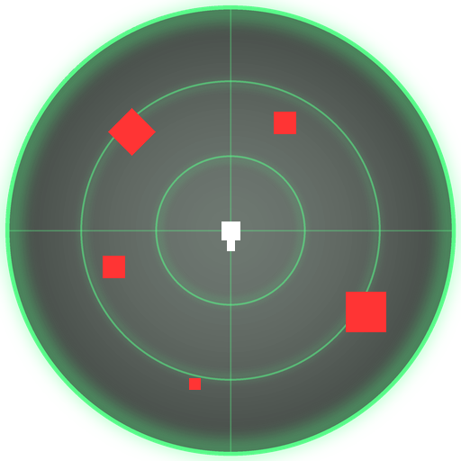

# Sixth Sense

**A 360° enemy radar HUD for Helldivers 2, running under HellForge with Bingus Shared Loader.**

Version **1.5.4** · GUID `bb72454c-ccd3-4e9b-927c-fcd80a09baf1`

Sixth Sense draws a round radar on your screen showing enemies all around you, including the ones behind you. It
turns with your view: up on the radar is where you are looking. Red squares are enemies, red diamonds are enemy
structures (turrets and the like), and the white marker in the middle is you. It only reads the game and draws on
the screen; it changes nothing in the game.

> This repository is private for now and is being prepared for sharing. Share the release zip, not the repo.

## Requirements
- **HellForge** (the offline Helldivers 2 launcher, game build 25480438).
- **Bingus Shared Loader v20** or newer (Nexus Mods / github.com/CowboyBingus/BingusSharedLoader). HellForge does
  not ship it.

## Install
1. Download **Bingus Shared Loader** (`Bingus-Shared-Loader-v20.zip`) and **`SixthSense.zip`**.
2. Open the HellForge launcher > **Mods** > **Add mods...** and pick both zips.
3. Switch **both** on (new mods start switched off; they show in the cosmetic group with a **LUA** tag).
4. Launch the game from HellForge. The radar appears in game; press **F7** to set it up.

Updating: add the new `SixthSense.zip` the same way. The GUID stays the same, so it replaces the old version and
keeps your settings.

## Features
- **360° radar** with enemies and enemy structures, range rings and cross hairs; enemies you lose sight of fade out.
- **F7 setup page** with two tabs:
  - **Display**: drag the **grab handle** to move the radar, drag a **corner** (or use the mouse wheel) to resize it.
  - **Settings**: sliders for **Size**, **Sensitivity** (range, 10 to 120 m), **Repeat rate** (how quickly dots
    update and fade), **Dot size** (S / M / L) and **Radar color**, plus **Shown / Hidden** and **Controls**.
- **Radar color**: green (default), white, yellow, red or light blue. It colours the radar display only (disc,
  rings, cross hairs); enemy markers always stay red.
- **Reset** (click twice) restores the defaults of the current tab; **hold F7 for 3 s** for a panic layout reset.
- **Shown / Hidden**: hide the radar during play without uninstalling it.
- **Keyboard + mouse or controller**: pick the scheme on the Settings tab. On a controller, hold **View / Back /
  touchpad for 2 s** to open the page.
- **Per-resolution layouts**: the radar's place and size are remembered for each screen resolution, and kept
  inside the part of the window the game lets mods draw on (Render Scale aware).

Full controls (mouse and controller): **[CONTROLS.md](CONTROLS.md)**.

## Settings and logs
Under HellForge they live in `<HellForge>\userdata\environment\Local\CowboyBingus\Helldivers2\Logs\`
(for example `D:\HellForge\userdata\...`):
- `sixth_sense.ini`: your settings, written by the F7 page (commented; close the game before editing by hand).
- `sixth_sense.log`: what the mod did; include it when reporting a problem.

Settings from the older **Rear Heat HUD** (`rear_heat_hud.ini`) are copied over once.

## Known limits
- Built and tested for the offline build HellForge runs (25480438) only.
- A Lua mod cannot take input away from the game: controller buttons used on the F7 page also reach the game, so set
  the radar up on the ship.
- Enemy recognition uses a built-in list of enemy ids; an enemy type not on it may not show.

## For developers
- Source: `src/sixth_sense.lua` (plus `src/enemy_tiers.lua.inc`). Build: `python3 tools/build.py` writes
  `SixthSense.zip` (needs the sibling `BingusSharedLoader` and `Treasure-Radar` checkouts). Offline test:
  `python3 tests/stub_test.py` (needs `lupa`).
- Release zip contents (`SixthSense.zip`): `manifest.json` (name "Sixth Sense v1.5.4", the GUID above) and
  `Addon/9ba626afa44a3aa3.patch_0` with its `.gpu_resources` and `.stream`: the Lua addon plus the textures from
  `assets/` (the radar disc and the F7 page's word labels). Zips are git-ignored; attach `SixthSense.zip` to a
  release instead of committing it.
- Changes: [CHANGELOG.md](CHANGELOG.md). Development notes: [docs/history/](docs/history/).

## Credits
Bingus Shared Loader (CowboyBingus), HellForge; texture drawing after Treasure Radar; controller discovery after Chef
Shared Loader; labels set in Poppins Bold (SIL Open Font License).
